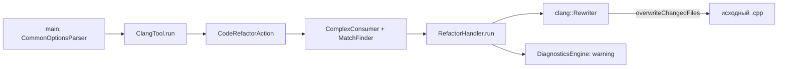

# CppMiddleProject8 — refactor_tool

Учебный проект 8-го спринта курса «Мидл разработчик С++» (`README.md:8`). Консольная утилита `refactor_tool` на Clang LibTooling разбирает C++-файл, находит три шаблона кода и правит исходник на месте:

- невиртуальный деструктор у класса, у которого есть наследники, — дописывает `virtual`;
- переопределённый метод без `override` — дописывает `override`;
- `const`-переменная цикла range-for нефундаментального типа, взятая по значению, — дописывает `&`.

Каждую правку утилита сопровождает предупреждением в формате диагностики компилятора (`src/RefactorTool.cpp:78-81, 96-99, 122-125`). Кроме того, в `STEP7_GUIDE.md` записан отчёт шага 7 с выводом AddressSanitizer и `perf`. Кто пользуется утилитой, кроме автора и проверяющих курса, из файлов не видно.

## Состояние

- Ветка `dev`, по которой написан этот документ: последний коммит `8c8c35f`, 2025-09-10, сообщение «v1.0.0» (`git log`). В ветке всего два коммита.
- В других ветках есть более поздние коммиты (`git log --all`): `main` — до 2026-08-10 (по сообщениям коммитов: MIT-лицензия, сборка под Windows через MSVC, CI); `release` и `test` — до 2026-11-08, тег `v1.0.0` стоит на вершине `release` (по сообщениям: приведение к ревизии 4.0.0 лабораторных требований, clang-tidy и clang-format, `recipe.ps1`). Ветка по умолчанию на GitHub — `release` (`git ls-remote --symref origin HEAD`). Все три ветки отходят от первого коммита `bd7ddbf`, а не от `dev` (`git merge-base`): коммит с реализацией `8c8c35f` есть только в `dev`, а в `main`, `release` и `test` `src/RefactorTool.cpp` — заготовка курса с пометками `todo`. В остальном содержимое этих веток здесь не описано.
- Тесты есть: 3 теста GoogleTest в `tests/test.cpp` и скрипт `check_refactor.sh`. Оба сравнивают результат с эталонными файлами.
- CI в ветке `dev` нет: нет ни `.github/`, ни `.gitea/`. Файла лицензии в `dev` тоже нет.
- Что не доделано:
  - `README.md` остался текстом шаблона курса («Шаблон репозитория…», `README.md:8`) и не описывает саму утилиту;
  - в `STEP7_GUIDE.md:78` автор пишет, что в `perf report` не получилось вывести имена функций;
  - в `tests/tests_data/leak_example.cpp:5` деструктор уже стоит как `virtual ~Base()`, хотя комментарий рядом говорит «Невиртуальный». То есть закоммичено состояние «после рефакторинга», а не исходный пример.

## Структура

| Путь | Назначение |
|---|---|
| `src/RefactorTool.cpp` | вся логика: матчеры AST, обработчики, `main` |
| `include/RefactorTool.h` | объявления `RefactorHandler`, `ComplexConsumer`, `CodeRefactorAction` |
| `CMakeLists.txt` | проект `clang-tutor`: поиск Clang/LLVM (≥ 19) по `CT_Clang_INSTALL_DIR`, общие флаги, подкаталоги `tests`, `src` |
| `src/CMakeLists.txt` | цель `refactor_tool`, линковка с `clangTooling clangBasic clangASTMatchers`; закомментированный блок плагинов из clang-tutor |
| `tests/CMakeLists.txt` | цель `refactor_tool_tests`, GoogleTest 1.12.1 через FetchContent |
| `tests/test.cpp`, `tests/main.cpp` | тесты GoogleTest |
| `tests/tests_data/test{1,2,3}.cpp`, `*_ref.cpp` | входные файлы и эталоны к ним |
| `tests/tests_data/for_refactor.cpp` | пример для ручного запуска и отладки (`.vscode/launch.json:12`) |
| `tests/tests_data/leak_example.cpp`, `perf_example.cpp` | примеры для шага 7 (ASan, perf) |
| `check_refactor.sh` | скрипт: прогоняет утилиту по test1–3 и сравнивает результат с эталонами через `diff -w -B` |
| `STEP7_GUIDE.md` | задание и отчёт шага 7 |
| `.devcontainer/` | Dockerfile (Ubuntu по digest, g++-15, LLVM/Clang 20, gdb, `linux-tools-common`), `devcontainer.json`, файл `default` (по формату — профиль Conan; ни один файл проекта на него не ссылается) |
| `.vscode/` | задача сборки, конфигурация отладки, ассоциации файлов |

## Архитектура



- `main` разбирает аргументы через `CommonOptionsParser` и запускает `ClangTool` с фабрикой `CodeRefactorAction` (`src/RefactorTool.cpp:180-189`).
- `ComplexConsumer` регистрирует три матчера (`src/RefactorTool.cpp:153-157`):
  - `NvDtorMatcher` — невиртуальный деструктор, объявленный в коде (не неявный) (`:130-135`);
  - `NoOverrideMatcher` — метод с `isOverride()` без атрибута `override`, не деструктор (`:137-144`);
  - `NoRefConstVarInRangeLoopMatcher` — переменная любого range-for (`:146-151`).
- `RefactorHandler::run` отправляет каждое совпадение в свой обработчик (`src/RefactorTool.cpp:36-51`). Наследников класса ищет `DescendantVisitor` (`RecursiveASTVisitor`), который обходит всю единицу трансляции (`src/RefactorTool.cpp:13-34`).
- В конце обработки файла `Rewriter::overwriteChangedFiles()` записывает изменения в сам исходный файл (`src/RefactorTool.cpp:174-178`).

Внешних сервисов нет. Нужны только установленные библиотеки LLVM/Clang.

## Сборка и запуск

Что нужно (по `CMakeLists.txt:1, 54-56`, `tests/CMakeLists.txt:1`, `.devcontainer/Dockerfile`):

- CMake ≥ 3.30. Корневой `CMakeLists.txt` просит 3.20, `tests/CMakeLists.txt` — 3.30.
- LLVM/Clang ≥ 19 с dev-заголовками и `ClangConfig.cmake`. Dev-контейнер ставит версию 20 (`.devcontainer/Dockerfile:21-23`).
- Компилятор C++. В контейнере это g++-15 (`.devcontainer/Dockerfile:16, 26`). Утилита собирается по C++17 (`CMakeLists.txt:73`), тесты по C++23 (`tests/CMakeLists.txt:4`).
- Доступ в сеть на этапе конфигурации: GoogleTest скачивается с GitHub (`tests/CMakeLists.txt:17`).

Сборка (`README.md:36-39`; то же в `.vscode/tasks.json:8-11`):

```bash
mkdir build && cd build
cmake -DCMAKE_BUILD_TYPE=Debug -DCT_Clang_INSTALL_DIR=/usr/lib/llvm-20/ ../
make
```

Обе цели, `refactor_tool` и `refactor_tool_tests`, попадают в `build/`: так задаёт `CMAKE_RUNTIME_OUTPUT_DIRECTORY` (`CMakeLists.txt:101`).

Запуск по образцу тестов и скрипта (`tests/test.cpp:18`, `check_refactor.sh:40`). Аргументы после `--` передаются компилятору как флаги, и база компиляции (`compile_commands.json`) тогда не ищется — так устроен `CommonOptionsParser` из LibTooling:

```bash
./build/refactor_tool path/to/file.cpp --
```

В `README.md:44-46` написано `cd build` и `./refactor_tool ../tests_data/for_refactor.cpp`. Каталога `tests_data/` в корне нет, файл лежит в `tests/tests_data/`. Кроме того, в этой команде нет `--`. Отладка запускается клавишей F5 (`.vscode/launch.json`, перед запуском выполняется задача сборки `GCC: Build Debug app`).

## Конфигурация

| Параметр | Где задаётся | Смысл | По умолчанию |
|---|---|---|---|
| `CT_Clang_INSTALL_DIR` | CMake, `CMakeLists.txt:23` | каталог установки Clang/LLVM | вычисляется из `Clang_ROOT` или `Clang_DIR`, иначе пусто, и конфигурация падает с `FATAL_ERROR` (`CMakeLists.txt:29-39`) |
| `Clang_ROOT` / `Clang_DIR` | CMake, `CMakeLists.txt:14-18` | другие способы указать Clang | не заданы |
| `CMAKE_BUILD_TYPE` | CMake | тип сборки | `Debug` (`CMakeLists.txt:76-79`; в `src/CMakeLists.txt:25` жёстко задан `Debug`) |
| аргументы командной строки | `CommonOptionsParser` | список исходных файлов; после `--` идут флаги компилятора | — |

Своих опций у утилиты нет: категория `refactor-tool options` объявлена (`src/RefactorTool.cpp:11`), но пустая. Остаются стандартные опции LibTooling, например `-p` и `--extra-arg` (их даёт `CommonOptionsParser`; `--help` в этой проверке не запускался). Переменных окружения код не читает.

## Использование

Файл `tests/tests_data/test3.cpp` после запуска утилиты должен совпасть с `test3_ref.cpp` (это проверяет тест `AddsReferenceToRangeFor`; в этой проверке не запускался):

```cpp
for (const auto x : vec)        // до
for (const auto& x : vec)       // после
for (const int x : ints)        // не меняется: фундаментальный тип
```

Пример вывода (`STEP7_GUIDE.md:83`; там сообщения ещё на русском, в текущем коде они на английском, `src/RefactorTool.cpp:124`):

```
/workspaces/CppMiddleProject8/build/perf_example.cpp:10:21: warning: Range-based for использует копирование; добавлена ссылка '&'
```

Файл перезаписывается на месте. Тесты и скрипт поэтому сначала копируют вход во временный файл.

## Тестирование

- `refactor_tool_tests` (`tests/test.cpp`) содержит три теста:
  - `AddsVirtualToDestructors` (test1);
  - `AddsOverrideToMethods` (test2);
  - `AddsReferenceToRangeFor` (test3).

  Каждый тест копирует вход в `temp_test_file.cpp`, вызывает `./refactor_tool temp_test_file.cpp --` через `system()`, требует код возврата 0 и сравнивает результат с эталоном побайтно, без учёта `\r` (`tests/test.cpp:9-39`). Пути `./refactor_tool` и `../tests/tests_data/...` относительные. Вывод (не проверялся): тесты работают, только если их запускать из каталога `build/`. Предупреждения утилиты тесты не проверяют.
- `check_refactor.sh` запускается из корня проекта после сборки: проверяет `./build/refactor_tool` и сравнивает результат с эталонами через `diff -w -B` (`check_refactor.sh:12, 51`).
- Для `for_refactor.cpp`, `leak_example.cpp` и `perf_example.cpp` эталонов нет.

## Известные ограничения и проблемы

- Команда запуска в `README.md` указывает на несуществующий путь (см. выше).
- `tests/CMakeLists.txt:41` регистрирует тесты через `gtest_discover_tests` без `WORKING_DIRECTORY`, а `enable_testing()` в проекте не вызывается нигде (`git grep`). Вывод из кода и документации CMake, не проверялся: `ctest` из `build/` тестов не найдёт вовсе; если тестирование включить, он будет запускать их из `build/tests`, а там нет ни `./refactor_tool`, ни пути `../tests/tests_data`. Зависимости цели тестов от цели `refactor_tool` тоже нет.
- `check_refactor.sh:30` вызывает `mkdir` без `-p`, а сам каталог `tests/tests_data/tmp` скрипт не удаляет никогда (удаляет только файлы прошедших тестов, `:56`). Поэтому при повторном запуске `mkdir` печатает ошибку; `set -e` в скрипте нет, и прогон продолжается.
- `check_refactor.sh` завершается с кодом 0 и при проваленных тестах: последним выполняется цикл вывода с `echo`, и его код всегда 0 (`check_refactor.sh:65-71`). Код 1 он возвращает только если нет утилиты или каталога с данными (`:19-28`).
- `override` вставляется сразу после закрывающей скобки параметров (`src/RefactorTool.cpp:93-95`). Вывод из кода, тестом не покрыт: у метода `void f() const` получится `void f() override const`, а это некорректный C++; то же для `noexcept` и ref-квалификаторов.
- `virtual` добавляется любому невиртуальному деструктору, если у класса есть хоть один наследник в единице трансляции, включая наследников из подключённых заголовков. Правится только main-файл (`isInMainFile`, `src/RefactorTool.cpp:57, 87, 108`).
- Вывод из кода, не проверен: матчер деструкторов не отличает объявление в классе от определения вне класса (`Base::~Base() {}`), а повторы отсекаются по позиции начала объявления (`src/RefactorTool.cpp:71-73`). Определение вне класса тоже получит `virtual`, что некорректно в C++.
- Range-for без `const` (`for (auto x : vec)`) не меняется: такое условие стоит в `src/RefactorTool.cpp:113`.
- Если `overwriteChangedFiles()` не смог записать файл, утилита печатает «Error applying changes to files.», но код возврата это не меняет (`src/RefactorTool.cpp:175-177`).

## Связанные документы

- [../README.md](../README.md) — исходное описание шаблона курса
- [../STEP7_GUIDE.md](../STEP7_GUIDE.md) — шаг 7: ASan и perf
- [../SPEC.md](../SPEC.md) — спецификация требований

## Об этом документе

Написан 2026-11-18 по коммиту `8c8c35f` (ветка `dev`); 2026-11-20 повторно сверен с кодом и исправлен. Все сведения взяты из файлов проекта. Запускались только `git ls-files`, `git log` (в том числе `--all`), `git branch -a`, `git diff --stat 8c8c35f origin/release` и `bash -n check_refactor.sh` (синтаксис в порядке); при перепроверке ещё `git merge-base`, `git show`, `git grep` по веткам `main`, `release`, `test` и `git ls-remote --symref origin HEAD`. Сборку, тесты, `ctest`, `check_refactor.sh` и `refactor_tool --help` не запускал: для них нужны LLVM/Clang dev-пакеты (в проекте рассчитано на `/usr/lib/llvm-20`) и сеть для FetchContent. Поэтому всё, что помечено как «вывод», не проверено запуском.
